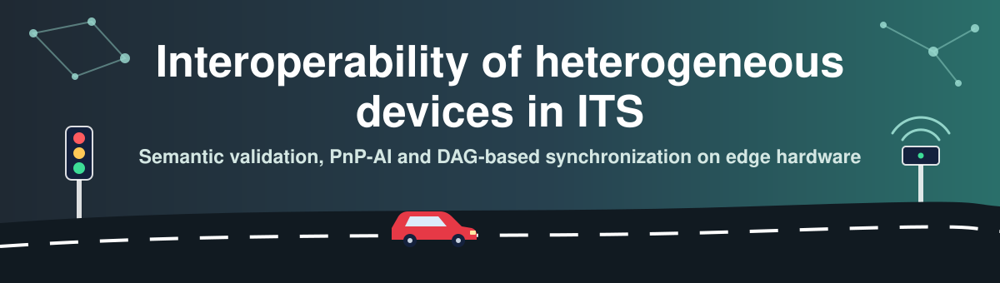
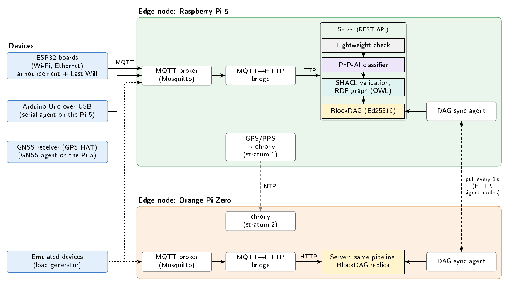

<p align="center">
  
</p>

<p align="center">
  <a href="LICENSE"></a>
  
  
  
  
  
  
  <a href="https://doi.org/10.5281/zenodo.23567519"></a>
</p>

<p align="center">
  <b>Semantic validation, PnP-AI and DAG-based synchronization on real edge hardware</b><br>
  Project PINV01-24 · Facultad de Ingeniería, Universidad Nacional de Asunción, Paraguay
</p>

<p align="center">
  
</p>

Traffic management depends on knowing which devices are in the field, what they are, whether they are still alive and in which order their events happened. Kept by hand, that registry does not keep up with heterogeneous sensors, roadside units and edge nodes.

This repository holds a system that keeps the registry without manual configuration, together with every experiment and every measured data file of the article *Interoperability of Heterogeneous Devices in Intelligent Transportation Systems: Semantic Validation, PnP-AI, and DAG-Based Synchronization on Edge Hardware* (T. Caballero and D. O. Gregor). Every number in the article comes from a script and from raw data committed here.

## What the system does

Devices announce themselves over MQTT. On each edge node a bridge turns the MQTT events into REST calls to a Flask server, which:

1. rejects malformed announcements with a lightweight check,
2. classifies the device into one of six hardware classes with a random forest trained on a calibrated catalogue of 114 commercial boards (PnP-AI),
3. validates the RDF description of the device with SHACL shapes, using the OWL subclass axioms of the ontology,
4. records the event in a hash-chained BlockDAG whose nodes are signed with Ed25519.

Next to each server, a synchronization agent pulls new DAG nodes from its peers and merges them independently of the order in which they arrive. Departures are detected through the MQTT Last Will.

## Try it in two minutes

You need Docker. The compose file starts two edge nodes, each with its own Mosquitto broker, server, bridge and synchronization agent, and creates their signing keys:

```
docker compose up -d --build
docker compose run --rm demo
```

The second command makes 10 emulated devices from the catalogue announce themselves, split between the two nodes. Each node registers its own devices and the agents replicate the DAG, so a few seconds later both servers report the same `digest`:

```
curl http://localhost:5000/api/dag/status
curl http://localhost:5001/api/dag/status
```

The logs of the bridges, the agents and the generator land in `docker/out/`. Stop everything with `docker compose down` (add `-v` to delete the keys).

> The containers are for trying the system. The timings in the article were measured on the boards without containers, and a run in Docker does not reproduce them.

## Running it on real hardware

```
pip install -r requirements.txt
python -m pytest -q
```

The configuration evaluated in the article is the default one: random forest, `resource` features, training on the calibrated catalogue (2000 announcements) and SHACL on every registration.

| On | Command |
|---|---|
| Each edge node: server | `python run_server.py` (add `--dag-key-file`, `--dag-trusted-keys` and `--dag-require-signatures` to sign and verify DAG nodes; keep the key outside the repository) |
| Each edge node: bridge | `python mqtt_http_bridge.py --mqtt-host localhost --http-host localhost` (use `--keepalive 600` under heavy load) |
| Each edge node: replication | `python3 experiments/dag_sync.py --local http://localhost:5000 --peer http://<peer>:5000 --csv sync.csv` |
| ESP32 boards | sketches in `firmware/esp32/examples/mqtt_device/`; copy `wifi_secrets.example.h` to `wifi_secrets.h` next to the sketch (it is ignored by git) |
| Linux boards | `python3 devices/linux_agent.py --mqtt-host <broker>` |
| GNSS receiver | `devices/gnss_agent.py` on the host of the receiver |
| Arduino Uno over USB | flash `firmware/arduino/mqtt_device_uno_serial/` and run `python devices/serial_agent.py` on the host |

Every script documents its options in its header and in `--help`.

## Repository layout

```
server/, run_server.py   Flask server: registration, classification, SHACL, DAG
mqtt_http_bridge.py      MQTT -> HTTP bridge; writes the event and onboarding CSVs
semantic_layer/          RDF store, SHACL validator, OWL/XML loader
ontology/                ITS base ontology, iot_pnp.owl extension, SHACL shapes
pnp_ai/                  features, classifier, catalogue-based announcement generator
blockdag/                DAG, Ed25519 signing, storage
devices/                 agents for Linux boards, the GNSS receiver and the Arduino Uno
firmware/                ESP32 sketches (Wi-Fi, Ethernet/PoE) and the Arduino Uno sketch
datasets/                catalogue of 114 boards with measured calibration; real announcements
baseline/                pipeline benchmarks, classifier evaluation, GNSS ablation
experiments/             experiment runners and analysis scripts
experiments/results/     raw data and analysis outputs of every experiment
figures/                 make_figures.py, its configuration and its input data
docker/                  broker configuration and key setup for docker-compose.yml
tests/                   automated tests
```

## Reproducing the article

Every data figure is regenerated with one command, which also writes a manifest with the SHA-256 of each input (`figures/README.md` lists the figures and their data):

```
python figures/make_figures.py
```

<details>
<summary><b>Where each table and result comes from</b></summary>

| Article | Script | Data |
|---|---|---|
| Calibration of the catalogue | `datasets/catalog/build_catalogo.py` (validator) | `datasets/catalog/catalogo_placas.csv` (measured columns) |
| Synthetic to real devices | `experiments/eval_synth_to_real.py` | `experiments/results/synth_to_real/` |
| Boards never seen in training | `experiments/eval_unseen_boards.py` | `experiments/results/unseen_boards/` |
| GNSS rule check | `baseline/run_gnss_rule_check.py` | `baseline/results_gnss_rule/` |
| GNSS receiver classification (10 runs) | `devices/gnss_agent.py` and the bridge | `experiments/results/gnss_classification/` |
| GNSS announcement validation | `experiments/run_gnss_validation.py` | `experiments/results/gnss_validation/` |
| Onboarding stages and clock bounds | `experiments/analyze_onboarding.py` | raw: `experiments/results/onboarding_*/`; analysis: `experiments/results/onboarding_analysis/` |
| Last Will of the wired boards | `experiments/run_lwt_trials.py` | `figures/data/lwt_ethernet/` |
| Load on the Raspberry Pi 5 and the Orange Pi Zero | `experiments/analyze_load.py` | raw: `experiments/results/load_pi5/`, `load_opi/`; analysis: `experiments/results/load_analysis/` |
| Emulated vs physical devices | `experiments/analyze_load.py --validate` | `experiments/results/load_pi5val/` and, with the `performance` governor, `load_pi5perf/` |
| Centralized vs distributed placement | `experiments/analyze_placement.py` | `experiments/results/placement/` |
| Convergence after partition | `experiments/run_partition.py`, `experiments/analyze_convergence.py` | `experiments/results/convergence/` |
| Pipeline stage costs (supplementary) | `baseline/run_benchmark.py`, `baseline/run_distributed_benchmark.py` | `baseline/results_pi5_catalog/` |
| Garbage-collector diagnostic (supplementary) | `baseline/diagnose_gc.py` | `baseline/results_pi5_catalog/gc_*` |
| Invalid announcements (supplementary) | `experiments/run_invalid_events.py` | `experiments/results/invalid_events/` |
| Classifier on the synthetic test set (supplementary) | `baseline/plot_classifier_metrics.py` | `baseline/results_classifier_hw_pc/` |
| GPS time to first fix and clock error (supplementary) | `experiments/ttff_gps.py`, chrony logs | `figures/data/ttff/`, `figures/data/chrony/` |

Each experiment folder keeps, next to the raw CSVs, the conditions of the node (`conditions.csv`: load average and, where the board exposes them, temperature and throttling) and, when two clocks are involved, the `chronyc tracking` readings taken at the start and at the end.

</details>

<details>
<summary><b>Where the data live</b></summary>

- `experiments/results/` holds the raw data and analysis outputs of each experiment.
- `figures/data/` holds the inputs of `make_figures.py`. Some are copies of files in `experiments/results/`; the time to first fix, chrony and Last-Will series exist only there.
- `baseline/results_*` holds the outputs of the benchmarks and the classifier evaluations.

</details>

<details>
<summary><b>Privacy</b></summary>

The NMEA logs have latitude and longitude removed. The coordinates in the GNSS validation and classification files are example coordinates in the centre of Asunción, not the position of the receiver. The only addresses in the chrony logs are those of public NTP servers. No Wi-Fi credentials or DAG keys are stored in the repository.

</details>

## Citation

If you use this code or data, please cite the article and the archived release of this repository:

> Caballero, T., & Gregor, D. O. (2026). *PINV01-24: code and data for "Interoperability of Heterogeneous Devices in Intelligent Transportation Systems: Semantic Validation, PnP-AI, and DAG-Based Synchronization on Edge Hardware"* (Version v1.0.0) [Software]. Zenodo. https://doi.org/10.5281/zenodo.23567520

```bibtex
@misc{caballero2026pinv0124,
  author       = {Caballero, Tatiana and Gregor, Derlis O.},
  title        = {{PINV01-24}: code and data for ``Interoperability of Heterogeneous Devices in Intelligent Transportation Systems: Semantic Validation, {PnP-AI}, and {DAG}-Based Synchronization on Edge Hardware''},
  howpublished = {Version v1.0.0 [software]. Zenodo},
  year         = {2026},
  doi          = {10.5281/zenodo.23567520},
  url          = {https://doi.org/10.5281/zenodo.23567520}
}
```

## Funding

Project PINV01-24, *Interoperabilidad de Equipos y Dispositivos con capacidad Plug and Play aplicado a Sistemas de Transportes Inteligentes: Un paso hacia las Smart Cities*, is co-funded by the Consejo Nacional de Ciencia y Tecnología (CONACYT), Paraguay, with the support of the Fondo para la Excelencia de la Educación y la Investigación (FEEI). The work was carried out at the Centro de Innovación Tecnológica (CITEC), Facultad de Ingeniería, Universidad Nacional de Asunción.

Released under the [MIT License](LICENSE).
